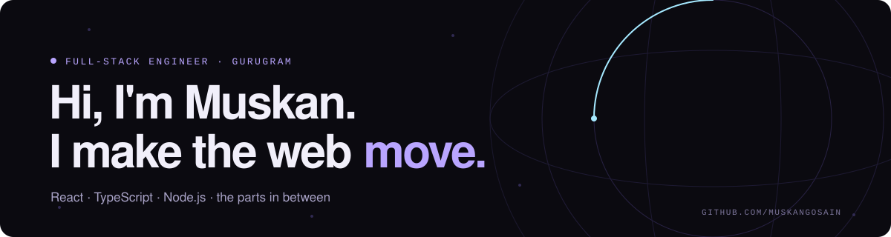

 

Full-stack engineer at **vCommission**, Gurugram. React, TypeScript, Node.js.

I build the whole thing: the interface people touch, and the system that has to be right underneath it. At work I built the complete frontend of VelocityX 3.0 from scratch, ship across two live SaaS platforms, and since September own the backend of one of them too.

### How I work

Words before code. The cost of a tradeoff stated next to the tradeoff. Something small that's true over something big that's impressive.

### Stack

React · Next.js · TypeScript · Node.js · Express · PostgreSQL · SQLite · Tailwind · Framer Motion · Three.js · some Go

### Elsewhere

[LinkedIn](https://www.linkedin.com/in/muskangosain) · themuskangosain@gmail.com
